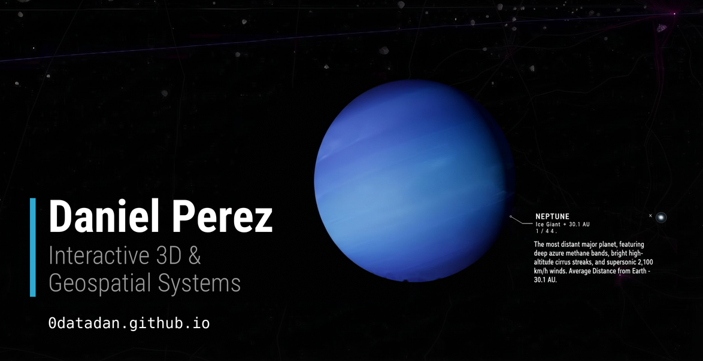

# NOVA Observatory (Universe Explorer)

An interactive 3D solar system and star map that runs in the browser, built with Three.js and Python.

**Live demo:** https://nova-observatory.vercel.app/



## What it is

I built this as a hands-on way to learn 3D web development with Three.js and see how a Python backend connects to a browser frontend. The app lets you orbit around planets and stars, click on objects to inspect them, take a narrated guided tour, and navigate with optional desktop webcam hand-tracking.

Because I'm still learning, a lot of this project came together through trial and error—especially figuring out how to smoothly move the 3D camera between orbiting planets and getting the tour narration to wait until the camera actually arrives at each stop.

## Features & v2 Hand-Tracking

- **Interactive 3D Solar System & Star Map (`static/index.html`)** – Renders planets, moons, orbital paths, starfields, lighting, and smooth camera transitions in Three.js.
- **v2 Webcam Hand-Tracking (`static/js/hand-control.js`)** – Optional desktop gesture control supporting two-hand zoom, pinch-to-orbit navigation, and point-to-target object selection with a targeting reticle.
  - **Privacy & Fallback:** Hand tracking runs locally in the browser—no camera video is uploaded or stored. On devices without a webcam, on mobile/touch screens, or when camera permission is declined, the app falls back cleanly to standard mouse, trackpad, and keyboard controls.
- **Narrated Guided Tour (`scripts/sync_nova_audio.py`, `tour_scripts.json`, `static/audio/tour/`)** – Generates consistent tour narration MP3s across all stops and coordinates playback with camera arrival.
- **Static Catalog Architecture (`static/catalog.json`, `backend/`)** – Started with a FastAPI backend serving planet and star data, then moved to a static `catalog.json` so the live app can be hosted for free on Vercel without keeping a backend server running.

## Stack

- **Frontend:** Vanilla JavaScript (ES modules), Three.js / WebGL, HTML5, CSS
- **Gesture Input:** Client-side webcam hand tracking (`static/js/hand-control.js`)
- **Data & Asset Pipeline:** Python, FastAPI (initial prototype in `backend/`), `edge-tts`, Pillow (`scripts/fetch_nasa_textures.py`, `scripts/sync_nova_audio.py`)
- **Hosting:** Vercel (static deployment from `static/`)

## Run locally

Since the frontend loads local JSON, texture, and audio files, you'll need a local HTTP server rather than opening the HTML file directly.

1. Clone the repo:
   ```bash
   git clone https://github.com/0DataDan/universe-explorer.git
   cd universe-explorer
   ```

2. Start a local server from the `static` folder:
   ```bash
   cd static
   python3 -m http.server 8000
   ```

3. Open `http://localhost:8000` in your browser.

*(Optional)* To regenerate planetary textures or guided-tour audio from the repo root:
```bash
python3 scripts/fetch_nasa_textures.py
python3 scripts/sync_nova_audio.py
```

## What I learned

- **World vs. local coordinates:** Early on, the camera would miss planets during the tour because they were nested inside orbiting groups. Switching to `getWorldPosition()` fixed the alignment.
- **Audio timing:** Playing narration immediately when a tour step triggered cut off the intro while the camera was still flying. Adding an arrival delay and a hold timer when the user clicks an info panel made the tour much easier to follow.
- **Static deployment:** Decoupling the planet data into `catalog.json` made it a lot simpler to host the live version on Vercel without keeping a backend server running.

## Known limitations

- **Scale compression:** Planetary radii and orbital distances are compressed for visual readability rather than drawn to literal 1:1 astronomical scale.
- **Hand-tracking environment:** Webcam gesture controls are desktop-only and depend on adequate lighting and browser camera permissions.
- **Browser performance:** High-resolution planetary textures and WebGL shaders can reduce frame rates on older integrated GPUs or low-power mobile devices.

## Data sources & credits

- **Planetary Textures & Astronomical Data:** Planetary surface maps and reference parameters are sourced from NASA / JPL / ESA public-domain datasets (fetched and normal-mapped via `scripts/fetch_nasa_textures.py`).
- **Tour Narration:** Guided tour audio files are synthetically generated using [`edge-tts`](https://github.com/rany2/edge-tts) for consistent voice output across stops. Please review `edge-tts` / Microsoft Edge TTS terms before commercial redistribution.
- **License:** Copyright (c) 2026 Daniel Perez. All rights reserved. See [LICENSE](LICENSE).
